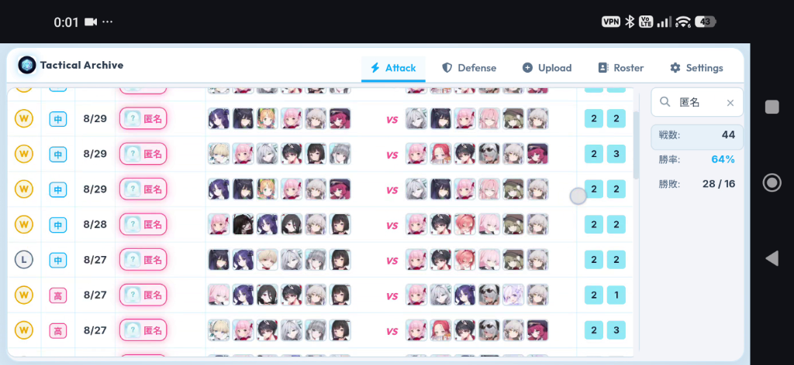
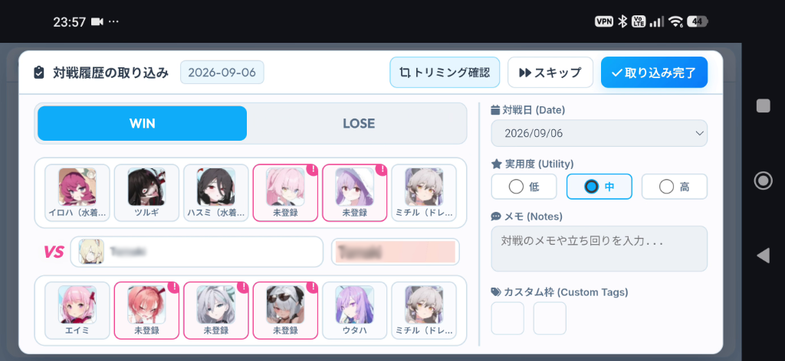

# Tactical Archive

『ブルーアーカイブ』戦術対抗戦の戦績記録ツール（Android / Windows PC対応）。
リザルト画面のスクリーンショットから生徒アイコンと相手プレイヤー名を認識し、戦績を記録・分析・検索できます。

---

## デモ版（ブラウザですぐ試せます）

- **[Webデモ版を試す（閲覧専用）](https://roundabout-oxygen.github.io/Tactic_Archive/demo/)**
  インストール不要で、ブラウザから今シーズンの実戦データ（対戦相手名は架空名）を使ってアプリの画面や分析機能を直接体験できます。
  まずは使い勝手や画面イメージを確認したい場合にご利用ください。

---

## ダウンロード

- **Android版 APK (v1.2.20)**: [TacticalArchive.apk のダウンロード](https://github.com/roundabout-oxygen/Tactic_Archive/raw/main/release/TacticalArchive.apk)
  - 端末内で画像認識を行い、手軽に対抗戦の記録がつけられるAndroidアプリです。
  - 初期設定手順は [note記事](https://note.com/glad_lilac3872/n/nb495e629f395) を参照してください。
- **PC版 Windows (v1.1.2)**: [TacticalArchivePC-v1.1.2.zip のダウンロード](https://github.com/roundabout-oxygen/Tactic_Archive/raw/main/release/TacticalArchivePC-v1.1.2.zip)
  - ダウンロードして解凍するだけですぐに使えるポータブル版（Windows 10/11 64bit）です。
  - 戦績データや設定はexeと同じフォルダ内の `data` フォルダに保存されるため、PCを汚さず完全独立して動作します。
  - スクリーンショット保存フォルダの自動巡回・整理、自動バックアップ、高精度なリザルト自動判別機能を備えています。

> **注意**: スクリーンショットの解像度やアスペクト比が変わると認識位置がズレます。取り込む画像のサイズは統一してください（PC版は16:9または4:3のプリセットに対応）。

---

## 機能一覧

- **リザルト画像認識**: リザルト画面のスクリーンショットから編成・勝敗・相手名を抽出して記録
- **戦績検索**: 対戦相手名（ひらがな・カタカナ両対応）による防衛編成・勝敗履歴の検索
- **データ管理**: JSONバックアップ・復元、CSV出力対応
- **ローカル保存**: データは端末内（IndexedDB）に保存され、戦績データを外部に送信することはありません

---

## 画面イメージ

| 戦績一覧・検索 | リザルト取り込み |
|:---:|:---:|
|  |  |

---

## 初期設定（キャリブレーション）

初回起動時のみ、端末の画面解像度に合わせて切り抜き枠の位置調整が必要です。

| 生徒枠 | 相手アイコン枠 | 相手名前枠 |
|:---:|:---:|:---:|
|  |  |  |

詳細な調整手順は [note記事](https://note.com/glad_lilac3872/n/nb495e629f395) を参照してください。

---

※ ブラウザで試せる簡易版（Web版）もあります: https://roundabout-oxygen.github.io/Tactic_Archive/

## 動作環境

- **Android版**: Android 7.0 以上
- **PC版**: Windows 10 / 11 (64bit)

---

## 免責事項

本ツールは非公式ツールです。権利元（株式会社Yostar / NEXON Games）とは関係ありません。
