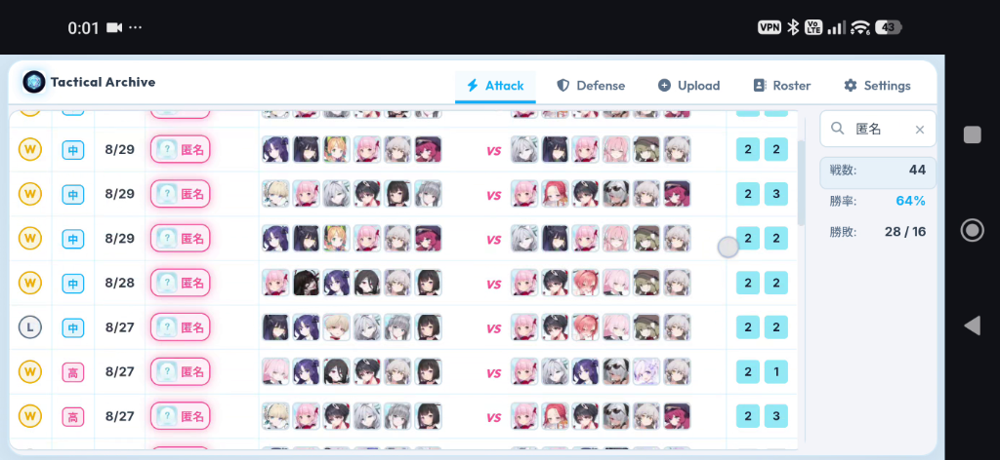
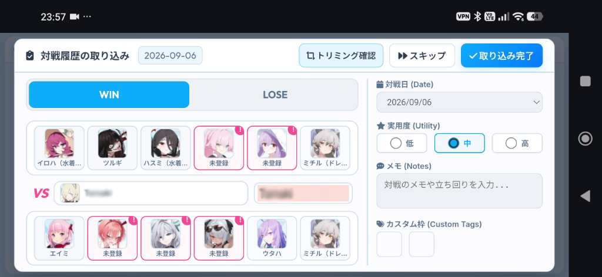
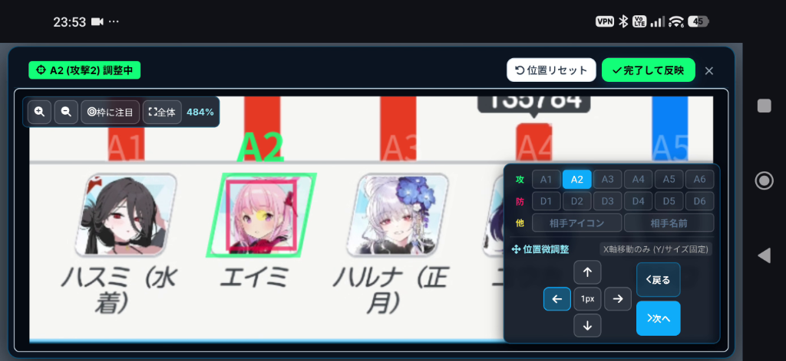
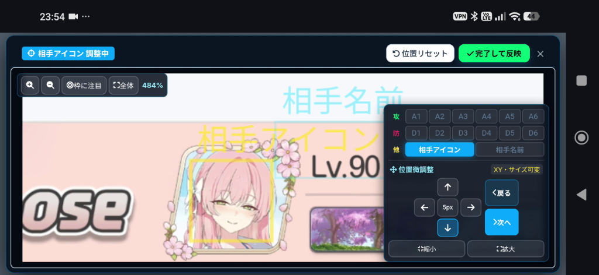
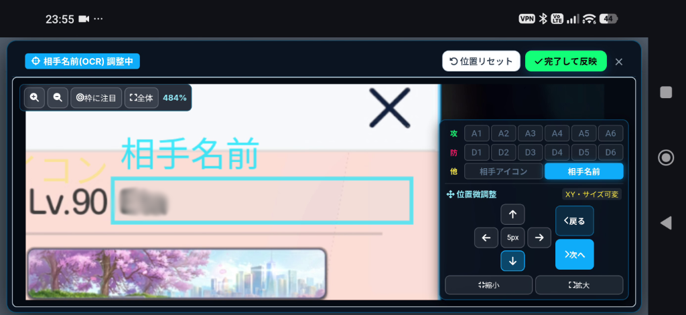

# Tactical Archive

『ブルーアーカイブ』戦術対抗戦の戦績記録ツール（Androidアプリ / Web版）。
リザルト画面のスクリーンショットから生徒アイコンと相手プレイヤー名を認識し、戦績を記録・検索できます。

---

## リンク

- **Web版**: https://roundabout-oxygen.github.io/Tactic_Archive/
- **Android版 APK (v1.2.8)**: [TacticalArchive.apk のダウンロード](https://github.com/roundabout-oxygen/Tactic_Archive/raw/main/release/TacticalArchive.apk)
- **初期設定手順（note）**: https://note.com/glad_lilac3872/n/nb495e629f395

> **注意**: スクリーンショットの解像度やアスペクト比が変わると認識位置がズレます。取り込む画像のサイズは統一してください。

---

## 機能一覧

- **リザルト画像認識**: リザルト画面のスクリーンショットから編成・勝敗・相手名を抽出して記録
- **戦績検索**: 対戦相手名（ひらがな・カタカナ両対応）による防衛編成・勝敗履歴の検索
- **データ管理**: JSONバックアップ・復元、CSV出力対応
- **ローカル保存**: データは端末内（IndexedDB）に保存され、外部への通信は行いません

---

## 画面イメージ

| 戦績一覧・検索 | リザルト取り込み |
|:---:|:---:|
|  |  |

---

## 初期設定（キャリブレーション）

初回起動時のみ、端末の画面解像度に合わせて切り抜き枠の位置調整が必要です。

| 生徒枠 | 相手アイコン枠 | 相手名前枠 |
|:---:|:---:|:---:|
|  |  |  |

詳細な調整手順は [note記事](https://note.com/glad_lilac3872/n/nb495e629f395) を参照してください。

---

## 動作環境

- **Android版**: Android 7.0 以上
- **Web版**: モダンブラウザ（Chrome, Safari, Edge 等）

---

## 免責事項

本ツールは非公式ツールです。権利元（株式会社Yostar / NEXON Games）とは関係ありません。
