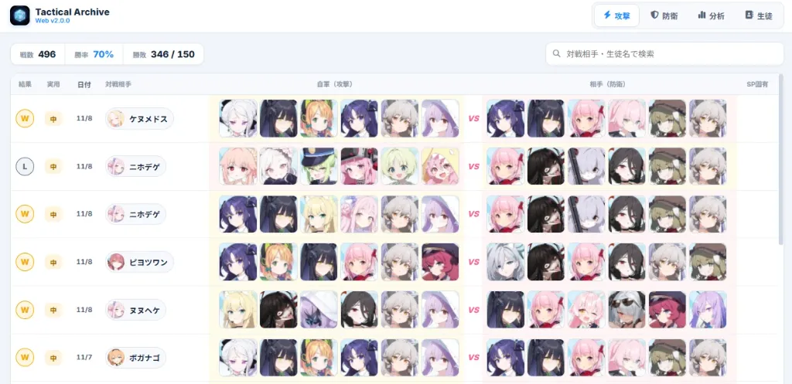
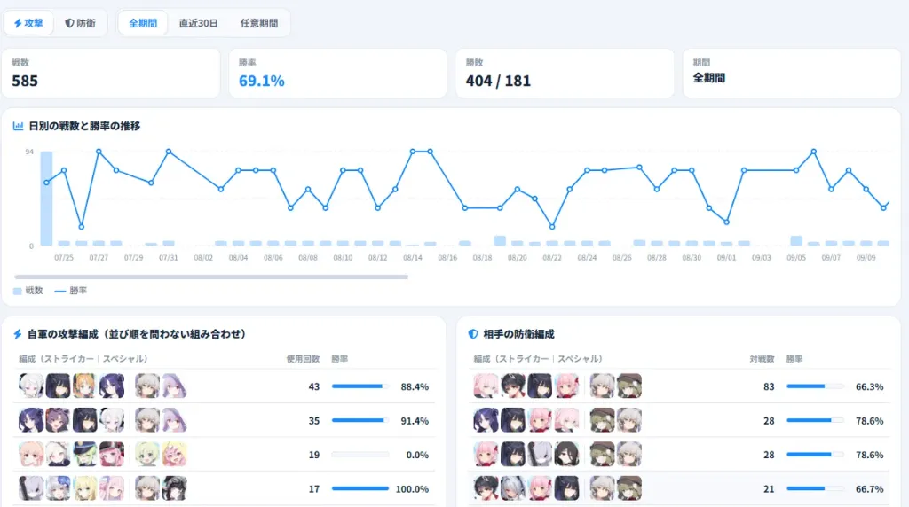
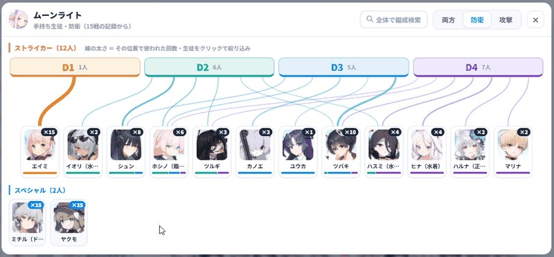
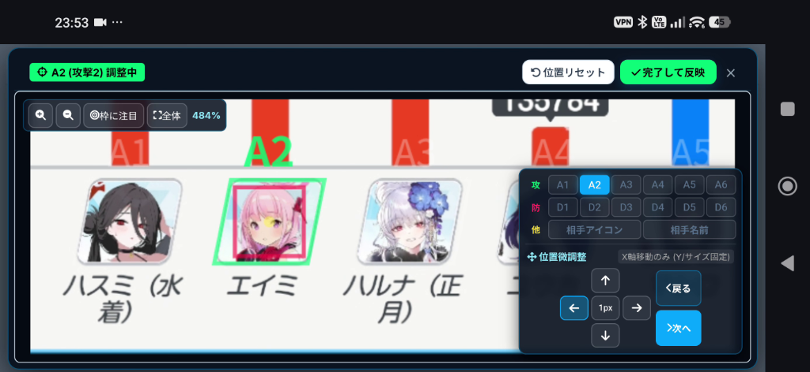
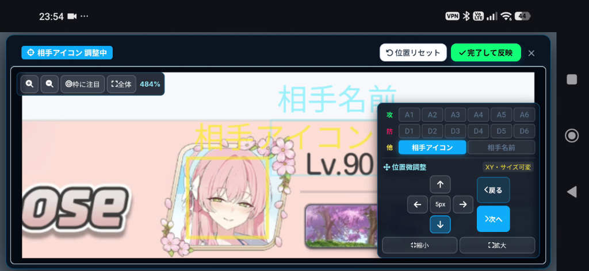
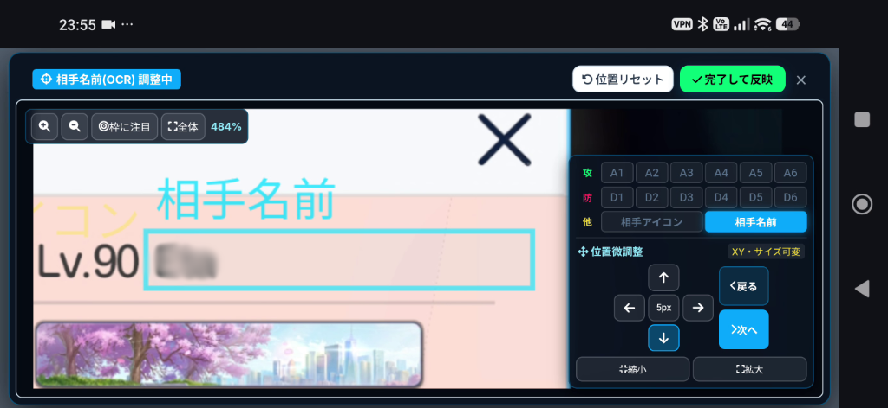

# Tactical Archive

『ブルーアーカイブ』戦術対抗戦の戦績記録ツール（Android / Windows PC対応）。
リザルト画面のスクリーンショットから生徒アイコンと相手プレイヤー名を自動認識し、戦績を記録・分析・検索できます。

---

## デモ版（ブラウザですぐ試せます）

- **[Webデモ版を試す（閲覧専用）](https://roundabout-oxygen.github.io/Tactic_Archive/demo/)**
  インストール不要で、ブラウザから今シーズンの実戦データ（対戦相手名は架空名）を使ってアプリの画面や分析機能を直接体験できます。
  まずは使い勝手や画面イメージを確認したい場合にご利用ください。

---

## 紹介記事（note）

ツールの詳しい機能や実際の活用方法については、以下のnote記事で紹介されています。
- **[note紹介記事：戦術対抗戦の記録・分析ツールについて](https://note.com/glad_lilac3872/n/n51b1fd166a97)**
- **[note初期設定ガイド：Android版の初回設定手順](https://note.com/glad_lilac3872/n/nb495e629f395)**

---

## ダウンロード

- **Android版 APK (v1.2.21)**: [TacticalArchive.apk のダウンロード](https://github.com/roundabout-oxygen/Tactic_Archive/raw/main/release/TacticalArchive.apk)
  - 端末内で画像認識を行い、手軽に対抗戦の記録がつけられるAndroidアプリです。
  - 初期設定手順は [note記事](https://note.com/glad_lilac3872/n/nb495e629f395) を参照してください。
- **PC版 Windows (v1.1.3)**: [TacticalArchivePC.zip のダウンロード](https://github.com/roundabout-oxygen/Tactic_Archive/raw/main/release/TacticalArchivePC.zip)
  - ダウンロードして解凍するだけですぐに使えるポータブル版（Windows 10/11 64bit）です。
  - 16:9 と 4:3 の両方のアスペクト比に対応しており、混在していても自動判別して取り込みます。
  - 戦績データや設定はexeと同じフォルダ内の `data` フォルダに保存されるため、PCを汚さず完全独立して動作します。
  - スクリーンショット保存フォルダの自動巡回・整理、自動バックアップ、高精度なリザルト自動判別機能を備えています。

> **注意**: PC版は 16:9 および 4:3 のスクリーンショットに両対応しています（サイズ違いは自動でリサイズされます）。スマホ版等の縦長画像や異なる比率は自動スキップされます。

---

## 主な機能と画面イメージ

### 1. 戦績一覧・検索
攻撃・防衛それぞれの勝敗、対戦相手名、自軍と相手の編成を一目で確認できます。対戦相手名や生徒名での絞り込み検索にも対応しています。

  

### 2. 勝率推移・編成分析（分析タブ）
日別の戦数と勝率の推移グラフ、自軍の得意な攻撃編成や相手の防衛編成ランキングを自動集計・可視化します。

  

### 3. 対戦相手の手持ち生徒・配置傾向の可視化
対戦相手の名前をタップすると、これまでの対戦記録から相手の手持ち生徒や配置傾向（D1〜D4のストライカーポジション）をライン図で直感的に把握できます。

  

---

## 機能一覧

- **リザルト画像認識**: リザルト画面のスクリーンショットから編成・勝敗・相手名を自動抽出して記録
- **戦績検索**: 対戦相手名（ひらがな・カタカナ両対応）や生徒名による防衛編成・勝敗履歴の検索
- **相手編成分析**: 対戦相手の手持ち生徒やポジション別配置傾向の可視化
- **勝率分析**: 日別の勝率推移グラフ、編成別勝率ランキングの集計・表示
- **データ管理**: JSONバックアップ・復元、CSV出力対応
- **ローカル保存**: データは端末内（IndexedDB）に保存され、戦績データを外部に送信することはありません

---

## 初期設定（キャリブレーション）

初回起動時のみ、端末の画面解像度に合わせて切り抜き枠の位置調整が必要です（PC版は16:9および4:3の最適化枠が組み込み済みのため調整不要です）。

| 生徒枠 | 相手アイコン枠 | 相手名前枠 |
|:---:|:---:|:---:|
|  |  |  |

詳細な調整手順は [note記事](https://note.com/glad_lilac3872/n/nb495e629f395) を参照してください。

---

※ ブラウザで試せる簡易版（Web版）もあります: https://roundabout-oxygen.github.io/Tactic_Archive/

## 動作環境

- **Android版**: Android 7.0 以上
- **PC版**: Windows 10 / 11 (64bit)

---

## 免責事項

本ツールは非公式ツールです。権利元（株式会社Yostar / NEXON Games）とは関係ありません。
